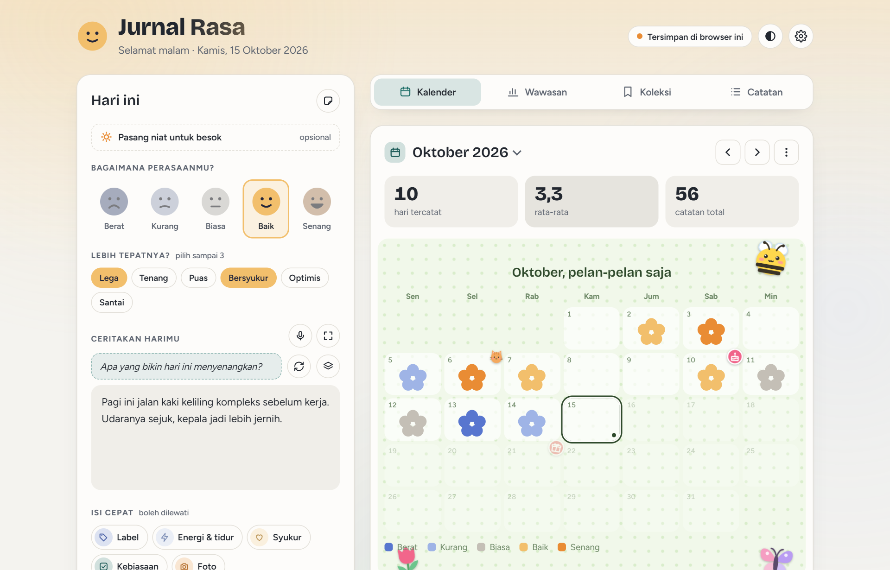
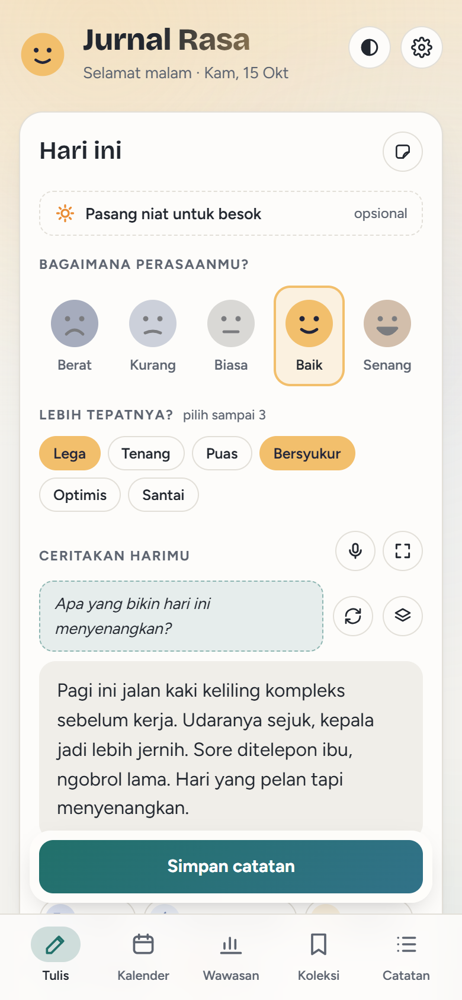
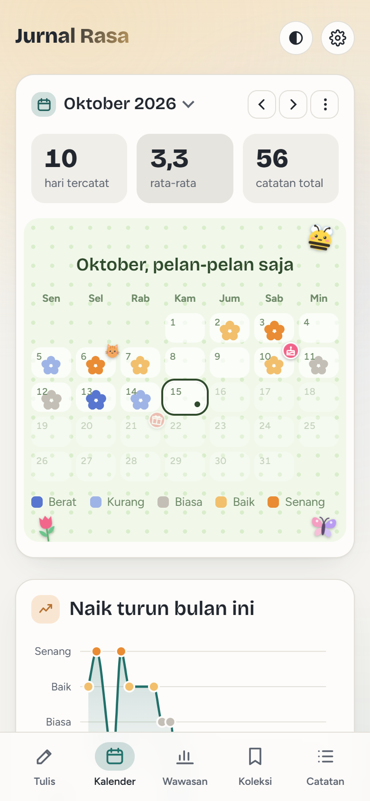
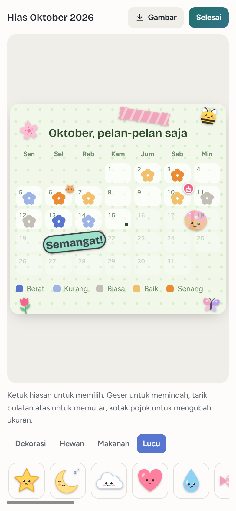
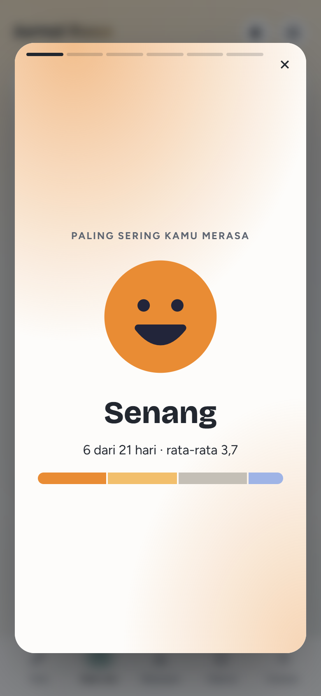

<div align="center">

# Jurnal Rasa

**Catat rasamu, kenali polanya.**

Jurnal mood harian buat kamu yang pengen lebih kenal sama perasaan sendiri.
Privat, bisa dipakai offline, dan nggak perlu bikin akun.

</div>



<table>
  <tr>
    <td align="center" width="25%"><br><sub><b>Tulis</b><br>Pilih rasa, lalu ceritakan harimu</sub></td>
    <td align="center" width="25%"><br><sub><b>Kalender</b><br>Sebulan rasamu dalam satu halaman</sub></td>
    <td align="center" width="25%"><br><sub><b>Hias</b><br>Tempel stiker di mana saja</sub></td>
    <td align="center" width="25%"><br><sub><b>Rekap</b><br>Cerita singkat tiap bulan</sub></td>
  </tr>
</table>

## Kenapa Jurnal Rasa

- **Privat sepenuhnya.** Semua catatan disimpan di perangkatmu sendiri. Tidak ada server, tidak ada akun, tidak ada yang ikut membaca.
- **Ringan dan cepat.** Cuma HTML, CSS, dan JavaScript. Bisa dipasang di HP seperti aplikasi biasa dan tetap jalan tanpa internet.
- **Lembut, bukan menuntut.** Tidak ada target menulis yang bikin merasa bersalah. Saat beberapa hari terasa berat, aplikasinya menawarkan latihan napas dan kontak bantuan.
- **Nyaman di mata.** Warna hangat yang tidak silau, mode gelap, pilihan huruf lebih besar, dan opsi mengurangi animasi.

## Fitur

### Menulis
- Pilih rasa dari **Berat** sampai **Senang**, lalu kata perasaan yang lebih tepat seperti cemas, lega, atau bangga
- Pertanyaan pemantik yang menyesuaikan rasa, atau pilih tema: diri sendiri, hubungan, kerja, masa depan, syukur
- Mode menulis fokus layar penuh, dan bicara jadi tulisan lewat mikrofon
- Isi cepat yang boleh dilewati: label, energi, jam tidur, tiga hal yang disyukuri, kebiasaan, dan satu foto
- Niat harian, refleksi mingguan, dan kilas balik catatan seminggu, sebulan, atau setahun lalu
- Draf tersimpan otomatis, dan hapus catatan bisa diurungkan

### Kalender yang bisa dihias
- Kalender rasa, grafik naik turun bulanan, dan ringkasan setahun
- **13 template halaman**, dari Buku tulis dan Bullet journal sampai Langit malam, Kebun bunga, dan Bawah laut. Di template lucu, tanda rasa berubah jadi bintang, bunga, hati, jejak kaki, atau gelembung
- **Lebih dari 100 stiker**: dekorasi, hewan, makanan, dan kata-kata. Bisa ditempel di tanggal atau di mana saja di halaman, lalu digeser, diputar, diubah ukurannya, atau ditaruh di balik tanggal
- Bikin stiker sendiri dari emoji atau tulisan pendek
- Simpan halaman bulan sebagai gambar PNG

### Wawasan
- Apa yang membuat harimu lebih baik, dilihat dari label, kebiasaan, tidur, dan energi
- Perasaan yang paling sering muncul tiap bulan, dan rasa per hari dalam seminggu
- **Rekap bulanan bergaya Wrapped** yang bisa disimpan sebagai gambar

### Koleksi
- Dinding syukur, daftar refleksi mingguan, buku stiker, kapsul waktu (surat untuk dirimu beberapa bulan lagi), dan lencana

### Privasi dan kenyamanan
- Kunci PIN, dan pilihan menyembunyikan isi catatan sampai disentuh
- Backup ke satu file dan pulihkan kapan saja
- Pengingat harian, tema terang dan gelap, huruf lebih besar, dan kurangi animasi
- Fitur tambahan bisa dimatikan supaya tampilannya lebih lega

## Mencoba

Tidak perlu install apa pun. Klik dua kali `index.html`, dan aplikasinya langsung terbuka di browser.

Supaya bisa dipasang di HP dan dipakai offline, aplikasinya perlu dibuka dari alamat web (https), misalnya lewat GitHub Pages atau Netlify. Setelah itu:

- **Android (Chrome):** buka Pengaturan, lalu Pasang di HP, atau lewat menu ⋮, lalu Instal aplikasi
- **iPhone (Safari):** tombol Bagikan, lalu Tambahkan ke Layar Utama

<details>
<summary><b>Coba di HP lewat Wi-Fi yang sama</b></summary>

1. Di folder proyek, jalankan `python -m http.server 8765 --bind 0.0.0.0`
2. Di HP yang terhubung ke Wi-Fi yang sama, buka `http://<IP-laptop>:8765`
3. Kalau tidak terbuka, izinkan Python di Windows Firewall untuk jaringan privat

Cara ini cukup untuk mencoba, tapi aplikasinya belum bisa dipasang atau dipakai offline karena belum https.

</details>

## Dibuat dengan

- **HTML, CSS, dan JavaScript murni.** Tanpa framework, tanpa proses build, tanpa dependensi.
- **Progressive Web App:** service worker untuk mode offline, dan manifest supaya bisa dipasang.
- **Canvas API** untuk menyimpan halaman kalender dan rekap sebagai gambar.
- **Web Speech API** untuk bicara jadi tulisan.
- **localStorage** untuk menyimpan semua data di perangkat.

<details>
<summary><b>Struktur proyek</b></summary>

| File | Isi |
|---|---|
| `index.html` | Struktur halaman dan dialog |
| `manifest.webmanifest` | Nama, ikon, dan warna aplikasi saat dipasang di HP |
| `sw.js` | Service worker untuk mode offline. Kalau menambah file baru, tambahkan ke `CORE` dan naikkan versi `CACHE` |
| `icons/` | Ikon aplikasi |
| `css/dasar.css` | Reset, warna tema terang dan gelap, huruf, komponen kecil |
| `css/tata-letak.css` | Header, banner, grid, panel, tab, dan penyesuaian HP |
| `css/editor.css` | Halaman menulis |
| `css/kalender.css` | Kalender, grafik, setahun rasa, menu halaman |
| `css/wawasan.css` | Wawasan dan daftar rekap |
| `css/catatan.css` | Daftar catatan, cari dan saring, cetak |
| `css/hidup.css` | Latar, gradasi rasa, animasi kecil |
| `css/koleksi.css` | Dinding syukur, refleksi, kapsul waktu, lencana |
| `css/dialog.css` | Semua dialog, termasuk pengaturan |
| `css/stiker.css` | Stiker di tanggal, laci stiker, buku stiker |
| `css/template.css` | Template halaman bulan dan layar hias |
| `css/cetak.css` | Tampilan saat dicetak atau disimpan ke PDF |
| `js/inti.js` | Konstanta, helper, state, dan penyimpanan bersama |
| `js/editor.js` | Menulis catatan, isi cepat, draf otomatis |
| `js/menulis.js` | Mode fokus, bicara jadi tulisan, tema pertanyaan |
| `js/refleksi.js` | Niat harian dan refleksi mingguan |
| `js/dukungan.js` | Kartu dukungan dan kontak bantuan (`HELP_LINES`) |
| `js/kalender.js` | Kalender, pemilih bulan, grafik, setahun rasa |
| `js/wawasan.js` | Faktor yang memengaruhi rasa dan rasa per hari |
| `js/rekap.js` | Rekap bulanan bergaya Wrapped |
| `js/catatan.js` | Cari, saring, daftar catatan, cetak |
| `js/koleksi.js` | Dinding syukur, kapsul waktu, lencana |
| `js/stiker.js` | Stiker bawaan, stiker buatan sendiri, mode tempel |
| `js/hewan.js` | Stiker hewan dan dekorasi tambahan |
| `js/lucu.js` | Stiker makanan dan kata-kata, serta template lucu (`CUTE_TPL`, `SHAPES`) |
| `js/hias.js` | Template, mode hias, dan simpan halaman sebagai PNG |
| `js/napas.js` | Latihan napas |
| `js/pengaturan.js` | Tema, backup, pengingat, PIN, dan pilihan tampilan |
| `js/sambutan.js` | Panduan untuk pengguna baru |
| `js/main.js` | Tab dan urutan saat aplikasi dibuka (dimuat paling akhir) |

File JS dan CSS dimuat berurutan seperti di `index.html`, tanpa build. Kalau mengubah bentuk tanda rasa di `css/template.css`, ubah juga `drawCell` di `js/hias.js` supaya gambar PNG tetap sama dengan tampilan.

Kode dirapikan dengan [Prettier](https://prettier.io):

```
npx prettier --write index.html "css/*.css" "js/*.js"
```

</details>

<details>
<summary><b>Data dan privasi</b></summary>

Semua data disimpan di `localStorage` browser, jadi hanya ada di browser dan perangkat itu. Catatan di laptop tidak otomatis pindah ke HP. Untuk memindahkannya, unduh backup di laptop lalu pulihkan di HP lewat Pengaturan.

| Kunci | Isi |
|---|---|
| `jurnal-rasa:entries` | Catatan per tanggal, termasuk kata perasaan, foto, syukur, dan kebiasaan |
| `jurnal-rasa:intents` | Niat harian dan hasilnya |
| `jurnal-rasa:reflections` | Refleksi mingguan |
| `jurnal-rasa:stickers` | Stiker per tanggal dan stiker buatan sendiri |
| `jurnal-rasa:calpages` | Template, judul, dan hiasan tiap bulan |
| `jurnal-rasa:draft` | Draf yang belum disimpan |
| `jurnal-rasa:tags`, `jurnal-rasa:habits` | Daftar label dan kebiasaan |
| `jurnal-rasa:capsules`, `jurnal-rasa:badges` | Kapsul waktu dan lencana |
| `jurnal-rasa:settings` | Pengaturan, PIN (disimpan sebagai hash), dan kontak yang dipercaya |
| `jurnal-rasa:theme`, `jurnal-rasa:ptheme` | Tema tampilan dan tema pertanyaan |

**Batasan:**
- Kapasitas `localStorage` sekitar 5 MB. Foto dikecilkan sampai 30–60 KB, jadi muat kira-kira 80–150 foto.
- Kunci PIN dan kapsul waktu hanya mengunci tampilan. Isinya tidak dienkripsi.
- Pengingat hanya muncul selama aplikasi terbuka.
- Setelah aplikasi diperbarui, versi barunya baru terlihat saat aplikasi dibuka untuk kedua kalinya.

</details>

## Catatan penting

Jurnal Rasa adalah alat bantu untuk mengenali perasaan, **bukan pengganti bantuan profesional**. Kalau kamu sedang merasa sangat berat atau berpikir untuk menyakiti diri sendiri, hubungi **112** atau layanan kesehatan jiwa Kemenkes di **119 ext 8**. Kamu tidak harus menghadapinya sendirian.

---

<div align="center">
<sub>Dibuat oleh <a href="https://github.com/masigoooel">masigoooel</a></sub>
</div>
